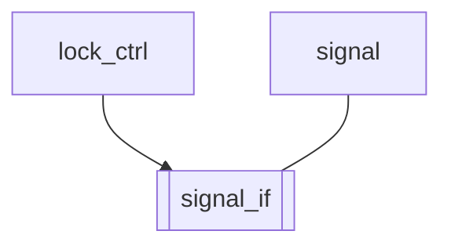

# 아키텍처 설계서 양식 (docs/swe2/architecture.md)

ID: 컴포넌트 `CMP-nnn`, 인터페이스 `IF-nnn`. 추적성 규약은 `requirements-analysis/references/traceability.md`.

```markdown
# SW 아키텍처 설계서

- 대상 SW: <이름>   버전: <x.y>   일자: YYYY-MM-DD
- 입력: docs/swe1/software-requirements.md (버전), docs/swe1/safety-requirements.md (버전)

## 1. 구조 개요
(한 문단과 mermaid 그림. 컴포넌트와 의존 방향)



## 2. 컴포넌트
| ID | 컴포넌트 (디렉터리) | 책임 (한 문장) | 소유 데이터 | ASIL/QM | 제공 인터페이스 | 요구 인터페이스 | 상위 ID |
|---|---|---|---|---|---|---|---|
| CMP-001 | lock_ctrl (`src/lock_ctrl/`) | 차속과 도어 상태로 잠금 명령을 결정한다 | 마지막 잠금 명령 | ASIL B | IF-001 | IF-002 | REQ-F-001, REQ-Q-001, SAF-001 |

## 3. 인터페이스
| ID | 인터페이스 (헤더) | 제공 컴포넌트 | 사용 컴포넌트 | 함수 | 호출 주기·순서 | 오류 처리 | 상위 ID |
|---|---|---|---|---|---|---|---|
| IF-001 | `lock_ctrl_if.h` | CMP-001 | CMP-003 | `status_t lock_ctrl_step(const lock_in_t *in, lock_out_t *out)` | 10 ms 주기, 신호 읽기 후 | 입력 NULL → STATUS_ERR_PARAM | REQ-F-001, SAF-001 |

### 3.1 데이터 타입
| 타입 | 필드 | 단위 | 범위 | 분해능 |
|---|---|---|---|---|

## 4. 의존 관계
| 컴포넌트 | 의존하는 인터페이스 | 방향 | 비고 |
|---|---|---|---|
(순환 없음을 확인한 날짜와 근거)

## 5. 공유 디렉터리
| 디렉터리 | 내용 (타입·상수만) | 사유 |
|---|---|---|

## 6. HW·OS 경계 (통합 테스트 스텁 지점)
| 경계 | 인터페이스 | 실제 구현 | 테스트 대체물 |
|---|---|---|---|

## 7. 동적 동작
(주기 실행 순서, 상태 전이 표, 오류 전파. 통합 테스트 IT의 근거)

## 8. 설계 근거와 대안
| 결정 | 선택 | 대안 | 이유 |
|---|---|---|---|

## 9. 개정 이력
| 버전 | 일자 | 변경 ID | 사유 | 영향받은 산출물 |
|---|---|---|---|---|
```

- 컴포넌트 표의 첫 열 `CMP-nnn`, 인터페이스 표의 첫 열 `IF-nnn`만 ID로 정의된다. 같은 ID를 두 행에서 정의하지 않는다.
- 컴포넌트 표의 `제공/요구 인터페이스` 열의 IF ID는 연결로도 읽힌다. 상위 ID 열에는 **요구사항 ID**를 쓴다.
