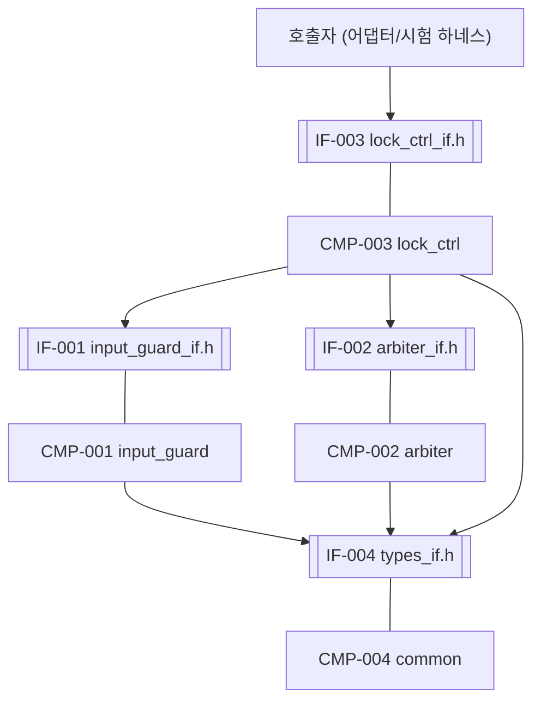

# SW 아키텍처 설계서

- 대상 SW: 전자식 차일드락 제어 SW (후석 좌, 우)   버전: 0.2 (이터레이션 1~2)   일자: 2026-11-27
- 입력: docs/swe1/software-requirements.md (v0.6), docs/swe1/safety-requirements.md (v0.6)
- 면책: 교육용 가상 OEM 입력에 대한 설계이며 준수·인증·ASIL 달성을 주장하지 않는다.
- 이터레이션 1은 입력 검사, 신선도, 결정 규칙(충돌, sensor_fault, 입력 무효·오래됨), 상태 보고를 다룬다. 이터레이션 2는 `arbiter`에 전역 해제 규칙(ignition off, 화재, 과온, 성인)과 문 단위 규칙(접근위험·override, ISOFIX, 자동 잠금, 운전자 명령)을 추가한다. 상태가 필요한 문별 접근위험 억제·override 기록은 `lock_ctrl`이 소유하고 `arbiter`는 입력과 기록을 받아 새 기록을 계산해 돌려준다(상태 없는 순수 판정 유지).

## 1. 구조 개요

호출자(차량 신호 어댑터 또는 시험 하네스)가 10 ms 주기로 `lock_ctrl`의 평가 함수를 호출한다. `lock_ctrl`은 평가 순서(now_ms 검사 → 입력 검사 → 결정)를 지휘하고 직전 확정 출력을 소유한다. 입력 검사와 입력 상태(저장 상태, 보관 값, 마지막 수신 시각)는 `input_guard`가, 출력 결정 규칙(규칙표, state)은 상태가 없는 `arbiter`가 맡는다. 세 컴포넌트가 함께 쓰는 타입은 공유 디렉터리 `common`에 둔다.

## 2. 컴포넌트

| ID | 컴포넌트 (디렉터리) | 책임 (한 문장) | 소유 데이터 | ASIL/QM | 제공 인터페이스 | 요구 인터페이스 | 상위 ID |
|---|---|---|---|---|---|---|---|
| CMP-001 | input_guard (`src/input_guard/`) | 스냅샷과 운전자 명령의 유효성을 검사하고 입력 항목별 입력 상태를 정한다 | 입력 항목별 저장 상태, 보관 값, 마지막 수신 시각, 직전에 받아들인 스냅샷 시각 | ASIL B | IF-001 | IF-004 | SWR-013, SWR-022, SWR-033, SWR-046, SAF-003, SAF-005 |
| CMP-002 | arbiter (`src/arbiter/`) | 정규화된 입력, 직전 확정 출력, 이번 평가의 명령, 문별 접근위험 기록으로 결정 규칙표에 따라 출력, state, 결정 이유, 경고, 새 접근위험 기록을 정한다 | 없음(상태 없는 순수 판정) | ASIL B | IF-002 | IF-004 | SWR-001, SWR-002, SWR-003, SWR-005, SWR-006, SWR-007, SWR-008, SWR-009, SWR-017, SWR-018, SWR-020, SWR-021, SWR-023, SWR-024, SWR-034, SWR-035, SWR-036, SWR-048, SAF-001, SAF-002, SAF-004 |
| CMP-003 | lock_ctrl (`src/lock_ctrl/`) | 평가 시각을 검사하고 입력 검사와 결정을 정해진 순서로 호출하며 직전 확정 출력을 보관해 결과를 호출자에게 낸다 | 직전 확정 출력, 직전에 받아들여진 평가의 now_ms, 마지막 결과, 문별 접근위험 억제·override 기록 | ASIL B | IF-003 | IF-001, IF-002, IF-004 | SWR-025, SWR-026, SWR-027, SWR-031, SWR-039, SWR-040, SWR-044, SAF-002, SAF-003 |
| CMP-004 | common (`src/common/`) | 컴포넌트들이 함께 쓰는 열거형, 구조체, 상태 코드 타입과 상수를 정의한다 | 없음 | ASIL B | IF-004 | 없음 | SWR-028, SWR-029, SWR-032, SWR-037, SWR-038, SWR-041, SWR-042, SWR-043, SWR-047 |

> ASIL/QM 분리: 이터레이션 1의 모든 컴포넌트가 ASIL B 입력(SAF)을 구현하므로 분리하지 않는다. 이후 이터레이션의 QM 기능(자동 잠금, 운전자 명령 적용, 이력)은 별도 컴포넌트로 두고 `arbiter`의 규칙 5 자리에서 ops 테이블로 연결해 ASIL B 코드와 간섭을 막는다.
> 코딩 제약(SWR-028, 029, 032, 037, 038, 041, 042, 043, 047)은 모든 컴포넌트에 적용되며 `common`에 대표로 연결한다(검증은 `tools/run.sh`의 build, rules).

## 3. 인터페이스

| ID | 인터페이스 (헤더) | 제공 컴포넌트 | 사용 컴포넌트 | 함수 | 호출 주기·순서 | 오류 처리 | 상위 ID |
|---|---|---|---|---|---|---|---|
| IF-001 | `input_guard_if.h` | CMP-001 | CMP-003 | `status_t input_guard_init(input_guard_t *guard)`, `status_t input_guard_update(input_guard_t *guard, uint32_t now_ms, const raw_snapshot_t *snapshot, normalized_inputs_t *out)`, `status_t input_guard_check_command(const raw_command_t *command, checked_command_t *out)` | 초기화 1회, update는 평가마다 정확히 1회(snapshot은 없으면 NULL), check_command는 명령이 있는 평가에서만 update 뒤에 호출 | 포인터 NULL → STATUS_ERR_PARAM (출력 불변). snapshot이 NULL인 것은 오류가 아님 | SWR-013, SWR-022, SWR-033, SWR-046 |
| IF-002 | `arbiter_if.h` | CMP-002 | CMP-003 | `status_t arbiter_decide(const arbiter_input_t *input, decision_t *out)` | 평가마다 1회, input_guard_update와 명령 검사 뒤 | 포인터 NULL, 입력 구조체 안의 NULL 포인터, 범위 밖 열거값(직전 출력) → STATUS_ERR_PARAM (출력 불변) | SWR-001, SWR-002, SWR-003, SWR-005, SWR-006, SWR-007, SWR-008, SWR-009, SWR-017, SWR-018, SWR-020, SWR-021, SWR-023, SWR-024, SWR-034, SWR-035, SWR-036, SWR-048 |
| IF-003 | `lock_ctrl_if.h` | CMP-003 | 호출자(범위 밖) | `status_t lock_ctrl_init(lock_ctrl_t *ctrl, const lock_ctrl_config_t *config)`, `status_t lock_ctrl_evaluate(lock_ctrl_t *ctrl, const lock_ctrl_input_t *input, lock_ctrl_result_t *result)`, `status_t lock_ctrl_get_result(const lock_ctrl_t *ctrl, lock_ctrl_result_t *result)` | init 1회 후 evaluate를 10 ms 주기로 호출. get_result는 언제든 | NULL → STATUS_ERR_PARAM (config가 NULL인 init은 오류가 아니며 기본 초기 출력 RELEASE). now_ms가 직전에 받아들여진 평가보다 작으면 STATUS_ERR_TIME (상태 불변) | SWR-025, SWR-026, SWR-027, SWR-031, SWR-039, SWR-040, SWR-044, SWR-048 |
| IF-004 | `types_if.h` | CMP-004 | CMP-001, CMP-002, CMP-003 | (함수 없음, 타입·상수만) | — | — | SWR-038, SWR-028 |

### 3.1 데이터 타입 (`types_if.h`)

| 타입 | 필드/값 | 단위 | 범위 | 분해능 |
|---|---|---|---|---|
| `status_t` | STATUS_OK, STATUS_ERR_PARAM, STATUS_ERR_TIME | — | — | — |
| `lock_cmd_t` | LOCK_RELEASE, LOCK_LOCK | — | — | — |
| `ctrl_state_t` | STATE_NORMAL, STATE_DEGRADED, STATE_FAULT, STATE_OFF | — | — | — |
| `validity_t` | VALIDITY_VALID, VALIDITY_INVALID, VALIDITY_STALE | — | — | — |
| `reason_t` | REASON_NONE, REASON_CRASH_CONFIRMED, REASON_SENSOR_FAULT, REASON_INPUT_INVALID, REASON_INPUT_STALE, REASON_CRASH_PENDING, REASON_IGNITION_OFF, REASON_FIRE, REASON_OVERTEMPERATURE, REASON_ADULT_PRESENT, REASON_APPROACH_RISK, REASON_APPROACH_OVERRIDE, REASON_ISOFIX, REASON_AUTO_LOCK, REASON_DRIVER_COMMAND | — | — | — |
| `warning_t` | WARNING_NONE, WARNING_SENSOR_FAULT | — | — | — |
| `command_status_t` | COMMAND_NONE, COMMAND_ACCEPTED, COMMAND_REJECTED | — | — | — |
| `crash_status_t` | CRASH_NONE, CRASH_PENDING, CRASH_CONFIRMED | — | — | — |
| `gear_t` | GEAR_P, GEAR_N, GEAR_D, GEAR_R | — | — | — |
| `input_item_t` | 입력 항목 13개(vehicle_speed, gear, source_timestamp, crash_status, 좌·우 접근위험, fire, overtemperature, adult_present, 좌·우 isofix, ignition_on, sensor_fault)와 ITEM_COUNT | — | 0~12 | — |
| `raw_value_t` | present(bool), value(double) | 항목별(ms, km/h, 열거 번호, 0/1) | 제한 없음(검사 대상) | — |
| `raw_time_t` | present(bool), value(int64_t) | ms | 제한 없음(검사 대상) | 1 ms |
| `raw_snapshot_t` | raw_time_t timestamp_ms, raw_value_t item[ITEM_COUNT] | — | — | — |
| `raw_command_t` | raw_value_t side, action, source | — | — | — |
| `normalized_inputs_t` | validity[ITEM_COUNT](입력 항목별), value[ITEM_COUNT](판정 값: 차속은 0.1 km/h 정수, 열거는 번호, boolean은 0/1) | 0.1 km/h | 차속 0~3000 | 0.1 km/h |
| `lock_ctrl_input_t` | now_ms(uint32_t), snapshot(const raw_snapshot_t *, 없으면 NULL), command(const raw_command_t *, 없으면 NULL) | ms | now_ms 0~4294967295 | 1 ms |
| `door_t` | DOOR_LEFT, DOOR_RIGHT, DOOR_COUNT | — | 0~1 | — |
| `checked_command_t` | status(command_status_t), side(0 left, 1 right, 2 all), action(0 lock, 1 unlock) | — | side 0~2, action 0~1 | — |
| `door_approach_t` | pending(bool, 억제 기록 있음), override_active(bool), pending_ms(uint32_t, 처음 억제된 시각) | ms | 0~4294967295 | 1 ms |
| `approach_state_t` | door[DOOR_COUNT](door_approach_t) | — | — | — |
| `arbiter_input_t` | inputs(const normalized_inputs_t *), previous(lock_outputs_t), command(checked_command_t), now_ms(uint32_t), approach(approach_state_t) | ms | — | — |
| `lock_outputs_t` | left, right (lock_cmd_t) | — | — | — |
| `decision_t` | outputs(lock_outputs_t), state, reason, warning, approach(approach_state_t, 새 접근위험 기록) | — | — | — |
| `lock_ctrl_config_t` | initial_outputs (lock_outputs_t, 시험 지원 SWR-039) | — | — | — |
| `lock_ctrl_result_t` | outputs, state, reason, priority_reason(reason과 같은 값), warning, command_status, input_validity[ITEM_COUNT], override_active[DOOR_COUNT] | — | — | — |
| `input_guard_t`, `lock_ctrl_t` | 호출자가 메모리를 제공하는 상태 구조체. 필드는 해당 컴포넌트만 읽고 쓴다(동적 할당 없음, SWR-029) | — | — | — |

## 4. 의존 관계

| 컴포넌트 | 의존하는 인터페이스 | 방향 | 비고 |
|---|---|---|---|
| CMP-003 lock_ctrl | IF-001, IF-002, IF-004 | CMP-003 → CMP-001, CMP-002, CMP-004 | 최상위 컴포넌트 |
| CMP-001 input_guard | IF-004 | CMP-001 → CMP-004 | |
| CMP-002 arbiter | IF-004 | CMP-002 → CMP-004 | |
| CMP-004 common | 없음 | — | 타입·상수만 |

순환 의존 없음: 의존 방향은 `lock_ctrl → {input_guard, arbiter} → common`이다(2026-11-27, `check_interfaces.py` I4로 구현 단계에서 재확인). `input_guard`와 `arbiter`는 서로를 모르며 `normalized_inputs_t`(공유 타입)로만 데이터를 주고받는다.

## 5. 공유 디렉터리

| 디렉터리 | 내용 (타입·상수만) | 사유 |
|---|---|---|
| `src/common/` | 열거형, 구조체, 상태 코드, 입력 항목 정의 | 세 컴포넌트가 입출력 데이터 형식을 같게 쓰기 위해. 로직은 넣지 않는다 |

## 6. HW·OS 경계 (통합 테스트 스텁 지점)

| 경계 | 인터페이스 | 실제 구현 | 테스트 대체물 |
|---|---|---|---|
| 호출자(차량 신호 어댑터, 10 ms 주기 스케줄러) | IF-003 | 범위 밖(OEM 시스템) | 통합 테스트의 시험 하네스가 `raw_snapshot_t`, now_ms를 직접 만들어 호출 |
| 시스템 시계 | 없음(시간은 호출자가 now_ms로 넘김, SWR-032) | 없음 | 고정 시계 입력 |
| 구동기(OEM-IF-005) | IF-003의 출력 `lock_ctrl_result_t` | 범위 밖 | 출력 값을 직접 읽어 검증 |

이 SW 안에는 HW·OS 호출이 없으므로 컴포넌트 사이에는 스텁을 쓰지 않고 실제 컴포넌트를 연결해 통합 테스트한다.

## 7. 동적 동작

### 7.1 평가 한 번(`lock_ctrl_evaluate`)의 순서 (SWR-044)

| 순서 | 수행 | 컴포넌트 | 실패 시 |
|---|---|---|---|
| ① | 인자 NULL 검사, now_ms가 직전에 받아들여진 평가의 now_ms보다 작은지 검사 | CMP-003 | 작으면 STATUS_ERR_TIME 반환, 이후 단계와 상태 갱신을 하지 않음 |
| ② | `input_guard_update`: 스냅샷 검사, 입력 항목별 저장 상태 갱신, 입력 상태(INVALID/STALE/VALID) 계산, 정규화 입력 생성 | CMP-001 | NULL 포인터면 STATUS_ERR_PARAM |
| ③ | 명령이 있으면 `input_guard_check_command`로 검사한 명령(상태, side, action)을 얻고, 없으면 COMMAND_NONE | CMP-001 | |
| ④ | `arbiter_decide`: 결정 규칙표(전역 규칙 1~8, 문 규칙 9~12, 규칙 13~14)와 state 결정. 직전 확정 출력, 명령, 문별 접근위험 기록을 입력으로 받는다 | CMP-002 | |
| ⑤ | 직전 확정 출력, 문별 접근위험 기록, 직전 now_ms를 갱신하고 결과를 구성해 호출자에게 낸다 | CMP-003 | |

### 7.2 결정 규칙 (CMP-002, SWR-023, 소프트웨어 요구사항 5.4절)

| 규칙 | 조건 | 출력 | 결정 이유 |
|---|---|---|---|
| 1 | crash_status VALID이고 CONFIRMED | 두 출력 RELEASE | CRASH_CONFIRMED |
| 2 | sensor_fault VALID이고 TRUE | 유지 | SENSOR_FAULT |
| 3 | 입력 항목 중 INVALID 있음 | 유지 | INPUT_INVALID |
| 4 | 입력 항목 중 STALE 있음 | 유지 | INPUT_STALE |
| 5 | ignition_on VALID이고 FALSE | 두 출력 RELEASE | IGNITION_OFF |
| 6~8 | fire, overtemperature, adult_present VALID이고 TRUE | 두 출력 RELEASE | FIRE, OVERTEMPERATURE, ADULT_PRESENT |
| 9~12 | (규칙 1~8이 없을 때) 문마다: 접근위험(override 아님) / ISOFIX / 차속 3.0 km/h 이상 / 이번 평가의 명령 | 그 문 LOCK / LOCK / LOCK / lock·unlock | APPROACH_RISK / ISOFIX / AUTO_LOCK / DRIVER_COMMAND(또는 APPROACH_OVERRIDE) |
| 13 | 문 규칙 없음, crash_status VALID이고 PENDING | 유지 | CRASH_PENDING |
| 14 | 그 밖 | 유지 | NONE |

### 7.3 state 결정 (CMP-002, SWR-035)

| FAULT 조건 | DEGRADED 조건 | ignition_on VALID이고 FALSE | state |
|---|---|---|---|
| 성립 | - | - | FAULT |
| 불성립 | 성립 | - | DEGRADED |
| 불성립 | 불성립 | 성립 | OFF |
| 불성립 | 불성립 | 불성립 | NORMAL |

### 7.3.1 문별 접근위험 억제·override (CMP-002 계산, CMP-003 보관, SWR-005, SWR-006, SWR-048)

| 사건 (문 D, 전역 규칙이 없는 평가) | 접근위험 기록의 변화 |
|---|---|
| D의 접근위험이 VALID로 FALSE | 억제 기록(pending)과 override를 지운다 |
| 접근위험 TRUE(VALID)이고 override 없음, D 대상 unlock 명령 | 기록이 없거나 10,000 ms를 초과했으면 pending=true, pending_ms=now_ms(출력은 LOCK 유지). 기록이 있고 경과 10,000 ms 이하이면 override 성립(pending=false, override_active=true), 이후 D는 규칙 12로 해제 |
| override 성립 중 | 접근위험이 VALID로 FALSE가 될 때까지 유지 |

### 7.4 입력 상태 전이 (CMP-001, SWR-013, 022, 046, 소프트웨어 요구사항 5.5절)

| 사건 | 저장 상태 변화 |
|---|---|
| 받아들인 스냅샷에서 항목 유효 | OK(보관 값 갱신) |
| 받아들인 스냅샷에서 항목 무효 | INVALID(보관 값 불변) |
| 스냅샷 거절(timestamp_ms 역행·미래·누락·범위 오류) | 모든 항목 INVALID |
| 스냅샷 없음 | 변화 없음 |

표시값: 저장 상태 INVALID → INVALID, 아니면 받아들인 스냅샷이 없거나 now_ms − 마지막 수신 시각 > 200 ms이면 STALE, 그 밖 VALID.

### 7.5 오류 전파

- 입력 오류(범위, 형식, 누락)는 오류 코드로 전파하지 않고 `input_validity`와 `reason`, `state`(DEGRADED)로 결과에 나타난다. 함수의 반환 상태 `STATUS_ERR_*`는 호출 규약 위반(NULL, 시각 역행)만 알린다.
- 어떤 오류에서도 직전 확정 출력은 유지되며, 예외는 유효한 충돌 CONFIRMED(해제)뿐이다.

## 8. 설계 근거와 대안

| 결정 | 선택 | 대안 | 이유 |
|---|---|---|---|
| 판정 로직을 상태 없는 함수로 분리 | `arbiter`는 입력과 직전 출력만 받아 결과를 계산 | 판정과 상태 보관을 한 컴포넌트에 둠 | 순수 함수는 MC/DC와 변이 시험이 쉽고 재현성(SWR-032) 확보가 쉽다. 상태 소유자를 컴포넌트마다 하나로 한다 |
| 입력 검사와 판정 분리 | `input_guard`와 `arbiter` | 하나의 큰 컴포넌트 | 입력 형식 규칙은 OEM 계약과 함께 바뀌고 판정 규칙은 이터레이션마다 확장되므로 변경 이유가 다르다 |
| 상태 구조체를 호출자 메모리에 둠 | `input_guard_t`, `lock_ctrl_t`를 호출자가 제공 | 컴포넌트 내부 static 인스턴스 | 동적 할당 금지(SWR-029)를 지키면서 시험마다 독립 인스턴스를 쓸 수 있다 |
| 시간을 인자로 받음 | now_ms 인자 | 시스템 시계 호출 | 고정 시계 재생(SWR-032, 이후 OEM-NFR-001) |
| 반환 상태와 결과 분리 | `status_t` 반환, 결과는 출력 구조체 | 결과를 반환값으로 | void 금지·단일 return 규칙(SWR-038, 043)을 지키며 출력 매개변수 사용 |
| 규칙 5 자리 | 이후 이터레이션에서 ops 테이블로 확장 | 지금 모든 규칙 구현 | 이터레이션 범위(개방-폐쇄) |

## 9. 개정 이력

| 버전 | 일자 | 변경 ID | 사유 | 영향받은 산출물 |
|---|---|---|---|---|
| 0.1 | 2026-11-27 | CMP-001, CMP-002, CMP-003, CMP-004, IF-001, IF-002, IF-003, IF-004 | 이터레이션 1 최초 작성 (단계 리뷰는 사용자 지시로 생략) | 없음 |
| 0.2 | 2026-11-27 | CMP-002, CMP-003, IF-001, IF-002, IF-003 | 이터레이션 2: 문 단위 규칙과 전역 해제 규칙 추가, 접근위험 기록(상태는 lock_ctrl이 소유), 검사한 명령 구조체, 결과에 override 상태 (단계 리뷰는 사용자 지시로 생략) | 상세 설계서 |
