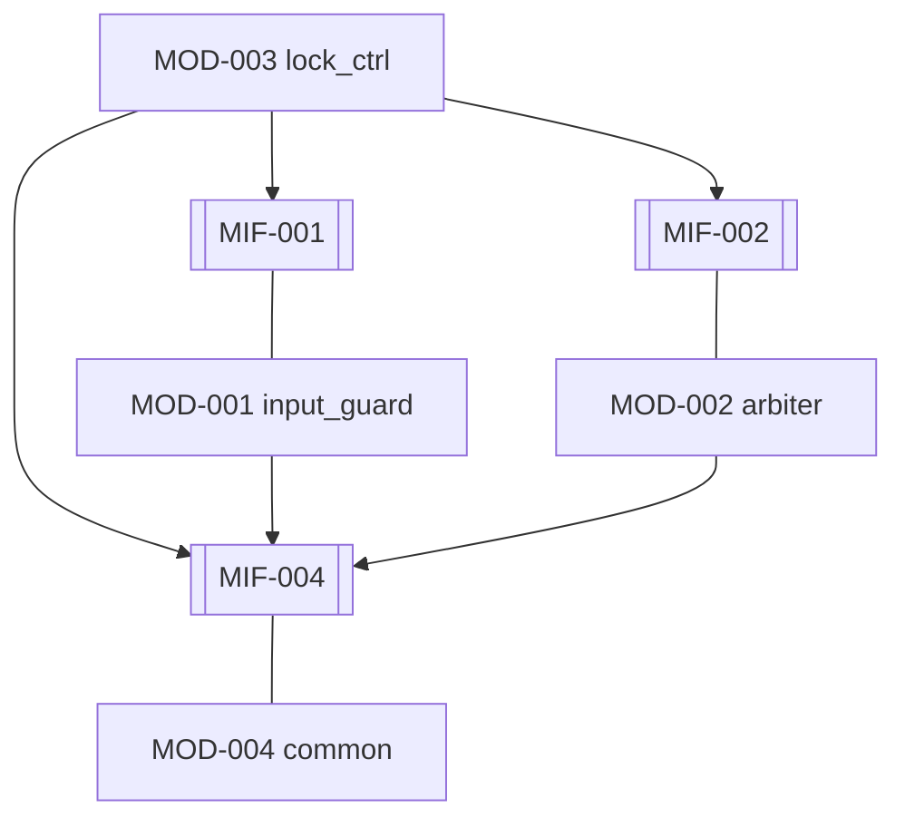
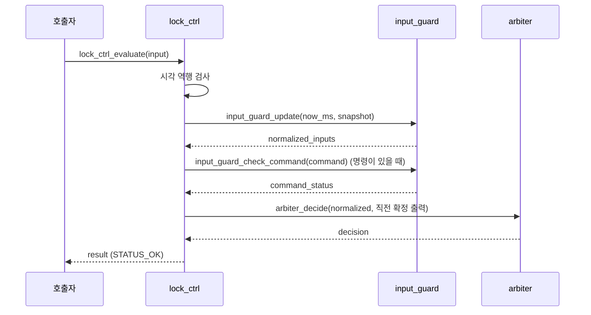
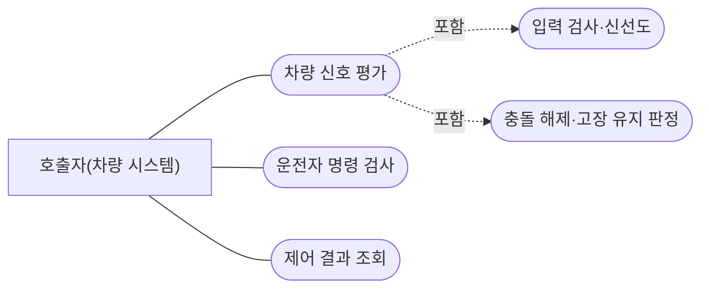

# SW 상세 설계서

- 대상 SW: 전자식 차일드락 제어 SW (후석 좌, 우)   버전: 0.5 (이터레이션 1~3)   일자: 2026-11-27
- 입력: docs/swe2/architecture.md (v0.3)
- 면책: 교육용 가상 OEM 입력에 대한 설계이며 준수·인증·ASIL 달성을 주장하지 않는다.
- 인터페이스 필수 기준: M1 호출됨 / M2 공개 함수 3개 이상 / M3 안전 요구 구현 / M4 상태 소유 (detailed-design 스킬 기준)
- 컴포넌트마다 모듈 하나를 두고(컴포넌트가 작아 더 쪼개면 SRP가 아니라 파편화가 된다), 모듈 안의 비공개 함수는 `static`이다. 모든 모듈은 M1(호출됨), M3 또는 M4에 해당하므로 인터페이스를 가진다.

## 1. 모듈

| ID | 모듈 (경로) | 책임 (한 문장) | 소유 데이터 | 인터페이스 필요(근거) | 상위 ID |
|---|---|---|---|---|---|
| MOD-001 | input_guard (`src/input_guard/`) | 스냅샷과 운전자 명령의 유효성을 검사하고 입력 항목별 입력 상태를 정한다 | `input_guard_t`(항목별 저장 상태, 보관 값, 마지막 수신 시각, 직전 스냅샷 시각) | 예 (M1, M3, M4) | CMP-001 |
| MOD-002 | arbiter (`src/arbiter/`) | 정규화된 입력과 직전 확정 출력으로 규칙표에 따라 출력, state, 결정 이유, 경고를 정한다 | 없음 | 예 (M1, M3) | CMP-002 |
| MOD-003 | lock_ctrl (`src/lock_ctrl/`) | 평가 순서를 지휘하고 직전 확정 출력을 보관해 결과를 낸다 | `lock_ctrl_t`(직전 확정 출력, 직전 now_ms, 마지막 결과, input_guard_t) | 예 (M1, M3, M4) | CMP-003 |
| MOD-004 | common (`src/common/`) | 공유 타입과 상수를 정의한다 | 없음 | 예 (M1, 공유 타입 헤더) | CMP-004 |
| MOD-005 | status_view (`src/status_view/`) | 조회 결과를 JSON 문자열로 직렬화한다 | 없음 | 예 (M1, 호출됨) | CMP-005 |
| MOD-006 | decision_log (`src/decision_log/`) | 제어 결정 이력을 링 버퍼로 보존하고 조회하게 한다 | `decision_log_t`(항목 100개, 건수, 쓰기 위치, 다음 ID) | 예 (M1, M4) | CMP-006 |

## 2. 모듈 인터페이스

| ID | 인터페이스 (헤더) | 제공 모듈 | 사용 모듈 | 구현하는 컴포넌트 인터페이스 | 상위 ID |
|---|---|---|---|---|---|
| MIF-001 | `input_guard_if.h` | MOD-001 | MOD-003 | IF-001 | CMP-001, IF-001 |
| MIF-002 | `arbiter_if.h` | MOD-002 | MOD-003 | IF-002 | CMP-002, IF-002 |
| MIF-003 | `lock_ctrl_if.h` | MOD-003 | 호출자(범위 밖) | IF-003 | CMP-003, IF-003 |
| MIF-004 | `types_if.h` | MOD-004 | MOD-001, MOD-002, MOD-003 | IF-004 | CMP-004, IF-004 |
| MIF-005 | `status_view_if.h` | MOD-005 | 호출자(범위 밖) | IF-005 | CMP-005, IF-005 |
| MIF-006 | `decision_log_if.h` | MOD-006 | MOD-003 | IF-006 | CMP-006, IF-006 |

## 3. 함수

모든 함수는 `status_t` 또는 값(판정 결과)을 반환하며 `void`가 없다. 판정 함수(`bool`, 열거형, 실수 반환)는 순수 함수다. 모든 함수는 `return`을 끝에 한 번만 둔다.

| ID | 함수 | 모듈 | 공개 | 목적 (한 문장) | 상위 ID |
|---|---|---|---|---|---|
| FN-001 | `status_t input_guard_init(input_guard_t *guard)` | MOD-001 | 예 | 입력 상태 저장소를 초기 상태로 만든다 | MOD-001, CMP-001, IF-001 |
| FN-002 | `status_t input_guard_update(input_guard_t *guard, uint32_t now_ms, const raw_snapshot_t *snapshot, normalized_inputs_t *out)` | MOD-001 | 예 | 스냅샷(있으면)을 검사해 저장 상태를 갱신하고 입력 항목별 입력 상태와 판정 값을 만든다 | MOD-001, CMP-001, IF-001 |
| FN-003 | `status_t input_guard_check_command(const raw_command_t *command, checked_command_t *out)` | MOD-001 | 예 | 운전자 명령의 유효성을 검사하고 검사한 명령(상태, side, action)을 낸다 | MOD-001, CMP-001, IF-001 |
| FN-004 | `static bool is_snapshot_time_acceptable(const input_guard_t *guard, uint32_t now_ms, const raw_snapshot_t *snapshot)` | MOD-001 | 아니오 | 스냅샷 시각이 받아들일 수 있는 값인지 판정한다 | MOD-001, CMP-001 |
| FN-005 | `static bool is_item_acceptable(const item_spec_t *spec, const raw_value_t *raw, bool snapshot_accepted, double upper_bound, int64_t *value)` | MOD-001 | 아니오 | 스냅샷이 받아들여졌고 입력 항목이 규칙에 맞을 때만 값을 낸다 | MOD-001, CMP-001 |
| FN-006 | `static bool validate_item(const item_spec_t *spec, const raw_value_t *raw, double upper_bound, int64_t *value)` | MOD-001 | 아니오 | 입력 항목 하나가 종류별 규칙에 맞는지 검사하고 내부 값을 낸다 | MOD-001, CMP-001 |
| FN-007 | `static bool validate_boolean(const raw_value_t *raw, int64_t *value)` | MOD-001 | 아니오 | 값이 존재하고 0 또는 1인지 검사한다 | MOD-001, CMP-001 |
| FN-008 | `static bool validate_integer_range(const raw_value_t *raw, double lower, double upper, int64_t *value)` | MOD-001 | 아니오 | 값이 존재하고 정수이며 범위 안인지 검사한다 | MOD-001, CMP-001 |
| FN-009 | `static bool validate_speed(const raw_value_t *raw, int64_t *value)` | MOD-001 | 아니오 | 차속이 존재하고 0.0~300.0 km/h이면 0.1 km/h 정수로 변환한다 | MOD-001, CMP-001 |
| FN-010 | `static double item_upper_bound(const item_spec_t *spec, const raw_snapshot_t *snapshot)` | MOD-001 | 아니오 | 입력 항목의 상한을 정한다(시각 항목은 스냅샷 시각, 나머지는 표의 값) | MOD-001, CMP-001 |
| FN-011 | `static validity_t compute_validity(const input_guard_t *guard, input_item_t item, uint32_t now_ms)` | MOD-001 | 아니오 | 입력 항목의 표시 입력 상태(INVALID, STALE, VALID)를 정한다 | MOD-001, CMP-001 |
| FN-012 | `static bool is_snapshot_stale(const input_guard_t *guard, uint32_t now_ms)` | MOD-001 | 아니오 | 받아들인 스냅샷이 없거나 마지막 수신 후 200 ms를 초과했는지 판정한다 | MOD-001, CMP-001 |
| FN-013 | `static status_t fill_normalized_inputs(const input_guard_t *guard, uint32_t now_ms, normalized_inputs_t *out)` | MOD-001 | 아니오 | 입력 항목별 입력 상태와 보관 값을 출력 구조체에 채운다 | MOD-001, CMP-001 |
| FN-014 | `status_t arbiter_decide(const arbiter_input_t *input, decision_t *out)` | MOD-002 | 예 | 규칙표와 state 결정표로 출력, state, 결정 이유, 경고, 새 접근위험 기록을 정한다 | MOD-002, CMP-002, IF-002 |
| FN-015 | `static bool has_item_value(const normalized_inputs_t *inputs, input_item_t item, int64_t expected)` | MOD-002 | 아니오 | 입력 항목이 VALID이고 판정 값이 기대값과 같은지 판정한다 | MOD-002, CMP-002 |
| FN-016 | `static bool has_any_validity(const normalized_inputs_t *inputs, validity_t validity)` | MOD-002 | 아니오 | 입력 항목 중 해당 입력 상태인 것이 하나라도 있는지 판정한다 | MOD-002, CMP-002 |
| FN-017 | `static arbiter_rule_t select_global_rule(const normalized_inputs_t *inputs)` | MOD-002 | 아니오 | 전역 규칙 1~8에서 처음 성립하는 규칙을 고른다 | MOD-002, CMP-002 |
| FN-018 | `static status_t apply_global_rule(arbiter_rule_t rule, const lock_outputs_t *previous, decision_t *out)` | MOD-002 | 아니오 | 전역 규칙에 따라 출력과 결정 이유를 채운다 | MOD-002, CMP-002 |
| FN-019 | `static ctrl_state_t decide_state(bool fault_condition, bool degraded_condition, bool off_condition)` | MOD-002 | 아니오 | FAULT, DEGRADED, OFF 조건으로 state를 정한다 | MOD-002, CMP-002 |
| FN-020 | `status_t lock_ctrl_init(lock_ctrl_t *ctrl, const lock_ctrl_config_t *config)` | MOD-003 | 예 | 제어기를 초기 상태로 만들고 초기 출력을 정한다 | MOD-003, CMP-003, IF-003 |
| FN-021 | `status_t lock_ctrl_evaluate(lock_ctrl_t *ctrl, const lock_ctrl_input_t *input, lock_ctrl_result_t *result)` | MOD-003 | 예 | 평가 한 번을 정해진 순서로 수행하고 결과를 낸다 | MOD-003, CMP-003, IF-003 |
| FN-022 | `status_t lock_ctrl_get_result(const lock_ctrl_t *ctrl, lock_ctrl_result_t *result)` | MOD-003 | 예 | 마지막 평가 결과(또는 초기 결과)를 낸다 | MOD-003, CMP-003, IF-003 |
| FN-023 | `static bool is_time_regressed(const lock_ctrl_t *ctrl, uint32_t now_ms)` | MOD-003 | 아니오 | now_ms가 직전에 받아들여진 평가보다 작은지 판정한다 | MOD-003, CMP-003 |
| FN-024 | `static status_t run_evaluation(lock_ctrl_t *ctrl, const lock_ctrl_input_t *input, lock_ctrl_result_t *result)` | MOD-003 | 아니오 | 입력 검사, 명령 검사, 결정을 호출해 결과를 구성하고 직전 출력과 접근위험 기록을 갱신한다 | MOD-003, CMP-003 |
| FN-025 | `static status_t build_result(const decision_t *decision, const normalized_inputs_t *inputs, command_status_t command, lock_ctrl_result_t *result)` | MOD-003 | 아니오 | 결정과 입력 상태로 결과 구조체(override 상태 포함)를 구성한다 | MOD-003, CMP-003 |
| FN-026 | `static status_t make_initial_result(const lock_outputs_t *initial, lock_ctrl_result_t *result)` | MOD-003 | 아니오 | 초기화 직후의 결과(SWR-025)를 만든다 | MOD-003, CMP-003 |
| FN-027 | `static bool is_valid_lock_outputs(const lock_outputs_t *outputs)` | MOD-002 | 아니오 | 두 출력 값이 모두 열거 범위 안인지 판정한다 | MOD-002, CMP-002 |
| FN-029 | `static status_t decide_doors(const arbiter_input_t *input, decision_t *out)` | MOD-002 | 아니오 | 문(좌, 우)마다 문 규칙을 적용해 출력, 결정 이유, 접근위험 기록을 정한다 | MOD-002, CMP-002 |
| FN-030 | `static door_result_t decide_door(const arbiter_input_t *input, door_t door, door_approach_t *approach)` | MOD-002 | 아니오 | 문 하나에 문 규칙 9~12를 적용하고 그 문의 접근위험 기록을 갱신한다 | MOD-002, CMP-002 |
| FN-031 | `static approach_step_t step_approach(door_approach_t current, bool risk, bool release, uint32_t now_ms)` | MOD-002 | 아니오 | 접근위험 입력과 해제 요청으로 문의 억제·override 기록을 한 단계 진행한다 | MOD-002, CMP-002 |
| FN-032 | `static bool command_matches(const checked_command_t *command, door_t door, int action)` | MOD-002 | 아니오 | 유효한 명령이 이 문을 대상으로 하는 해당 동작인지 판정한다 | MOD-002, CMP-002 |
| FN-033 | `static bool targets_door(int side, door_t door)` | MOD-002 | 아니오 | 명령의 side가 이 문을 가리키는지 판정한다 | MOD-002, CMP-002 |
| FN-034 | `static bool is_speed_at_least(const normalized_inputs_t *inputs, int64_t threshold)` | MOD-002 | 아니오 | 차속 판정 값이 기준 이상인지 판정한다 | MOD-002, CMP-002 |
| FN-035 | `static reason_t apply_fallback_reason(const normalized_inputs_t *inputs, reason_t reason)` | MOD-002 | 아니오 | 문 규칙이 없어 이유가 NONE이면 충돌 PENDING 이유를 적용한다 | MOD-002, CMP-002 |
| FN-036 | `static lock_cmd_t get_door_output(const lock_outputs_t *outputs, door_t door)` | MOD-002 | 아니오 | 문의 출력 값을 꺼낸다 | MOD-002, CMP-002 |
| FN-037 | `status_t status_view_format(const lock_ctrl_result_t *result, char *buffer, size_t size)` | MOD-005 | 예 | 조회 결과를 널 종료 JSON 문자열로 직렬화한다 | MOD-005, CMP-005, IF-005 |
| FN-038 | `static const char *name_of(const char *const *names, int count, int value)` | MOD-005 | 아니오 | 열거값의 이름을 낸다(범위 밖이면 "UNKNOWN") | MOD-005, CMP-005 |
| FN-039 | `static int fill_scalar_pieces(const lock_ctrl_result_t *result, const char **pieces)` | MOD-005 | 아니오 | 출력·이유·상태 등 스칼라 필드의 문자열 조각을 채우고 조각 수를 낸다 | MOD-005, CMP-005 |
| FN-040 | `static int fill_validity_pieces(const lock_ctrl_result_t *result, const char **pieces)` | MOD-005 | 아니오 | 입력 항목별 입력 상태의 문자열 조각을 채우고 조각 수를 낸다 | MOD-005, CMP-005 |
| FN-041 | `static status_t join_pieces(const char *const *pieces, int count, char *buffer, size_t size)` | MOD-005 | 아니오 | 조각을 이어 버퍼에 쓰고, 부족하면 빈 문자열과 STATUS_ERR_BUFFER를 낸다 | MOD-005, CMP-005 |
| FN-042 | `status_t decision_log_init(decision_log_t *log)` | MOD-006 | 예 | 이력을 비우고 이벤트 ID를 1로 되돌린다 | MOD-006, CMP-006, IF-006 |
| FN-043 | `status_t decision_log_append(decision_log_t *log, const decision_entry_t *entry)` | MOD-006 | 예 | 이력에 1건을 추가하고 이벤트 ID를 부여하며 100건을 넘으면 가장 오래된 것을 덮어쓴다 | MOD-006, CMP-006, IF-006 |
| FN-044 | `status_t decision_log_count(const decision_log_t *log, uint32_t *count)` | MOD-006 | 예 | 보존 중인 이력 건수를 낸다 | MOD-006, CMP-006, IF-006 |
| FN-045 | `status_t decision_log_get(const decision_log_t *log, uint32_t index, decision_entry_t *out)` | MOD-006 | 예 | 오래된 것부터 센 index번째 항목을 낸다 | MOD-006, CMP-006, IF-006 |
| FN-046 | `static bool is_decision_change(const lock_ctrl_result_t *previous, const lock_ctrl_result_t *next)` | MOD-003 | 아니오 | 출력, state, 결정 이유 중 하나가 달라졌는지 판정한다 | MOD-003, CMP-003 |
| FN-047 | `status_t lock_ctrl_get_log_count(const lock_ctrl_t *ctrl, uint32_t *count)` | MOD-003 | 예 | 이력 건수를 조회한다 | MOD-003, CMP-003, IF-003 |
| FN-048 | `status_t lock_ctrl_get_log_entry(const lock_ctrl_t *ctrl, uint32_t index, decision_entry_t *entry)` | MOD-003 | 예 | 이력 항목을 오래된 것부터 조회한다 | MOD-003, CMP-003, IF-003 |
| FN-049 | `static status_t record_decision(lock_ctrl_t *ctrl, const lock_ctrl_result_t *built, uint32_t now_ms)` | MOD-003 | 아니오 | 결정이 바뀌었으면 이력에 추가한다 | MOD-003, CMP-003 |
| FN-028 | `static bool is_valid_initial_outputs(const lock_outputs_t *outputs)` | MOD-003 | 아니오 | 초기 출력의 두 값이 모두 열거 범위 안인지 판정한다 | MOD-003, CMP-003 |

### 3.1 공통 설계 사항

- **상태 구조체**: `input_guard_t`, `lock_ctrl_t`는 호출자가 메모리를 제공한다(동적 할당 없음). 필드는 소유 모듈만 읽고 쓴다.
- **입력 항목 표** `item_spec_t {kind, lower, upper}` (`input_guard.c`의 `static const`, 항목 순서는 `input_item_t`):

| 항목 | kind | lower | upper |
|---|---|---|---|
| ITEM_VEHICLE_SPEED | SPEED | 0.0 | 300.0 |
| ITEM_GEAR | ENUM | 0 | 3 |
| ITEM_SOURCE_TIMESTAMP | TIME | 0 | (스냅샷 시각, 실행 시 결정) |
| ITEM_CRASH_STATUS | ENUM | 0 | 2 |
| ITEM_REAR_LEFT_APPROACH_RISK ~ ITEM_SENSOR_FAULT (나머지 9개) | BOOL | 0 | 1 |

- **NaN·무한대**: 검사 함수는 NaN과 무한대를 별도 조건으로 검사하지 않는다. 모든 비교(`==`, `>=`, `<=`)가 거짓이거나 범위를 벗어나 자연히 INVALID가 된다. 별도 조건은 MC/DC로 독립 효과를 보일 수 없는 중복 조건이 되기 때문이다.
- **원자성**: `lock_ctrl_evaluate`는 now_ms 검사에 실패하면 어떤 상태도 바꾸지 않는다(SWR-040). 하위 호출이 `STATUS_ERR_PARAM`을 반환하면 직전 확정 출력과 직전 now_ms를 갱신하지 않는다.
- **오류 처리 정책**: 반환 `STATUS_ERR_*`는 호출 규약 위반(NULL, 시각 역행)만 알리고, 입력 값의 오류는 입력 상태로 결과에 나타난다.
- **테스트 가능성**: `lock_ctrl`의 방어 경로(하위 호출이 오류를 반환하는 경우)는 단위 테스트에서 스텁(`tests/unit/stubs/`)으로 하위 컴포넌트를 대체해 도달한다. 항상 성공하는 `status_t` 반환 체인과 도달할 수 없는 `default` 분기는 두지 않는다.

### FN-001 `input_guard_init`
- **매개변수**: `guard` 출력(NULL 불가)
- **반환값**: `STATUS_OK`, `STATUS_ERR_PARAM`(guard가 NULL)
- **사후 조건**: 모든 항목의 저장 상태 OK(`invalid=false`), 보관 값 0, `has_snapshot=false`, `last_receive_ms=0`, `last_snapshot_ms=0`
- **부작용**: `*guard`만 변경. NULL이면 아무것도 바꾸지 않는다
- **오류 처리**: `guard == NULL` → `STATUS_ERR_PARAM`

### FN-002 `input_guard_update`
- **매개변수**: `guard` 입출력(NULL 불가), `now_ms` 0~4294967295 ms, `snapshot` 읽기 전용(없으면 NULL), `out` 출력(NULL 불가)
- **반환값**: `STATUS_OK`, `STATUS_ERR_PARAM`(guard 또는 out이 NULL)
- **알고리즘**: ① 파라미터 검사. ② snapshot이 있으면 FN-004로 시각을 판정해 `accepted`를 정한다. `accepted`이면 `last_snapshot_ms`와 `last_receive_ms`를 스냅샷 시각으로, `has_snapshot=true`로 한다. 항목마다 FN-005(accepted이고 FN-006을 통과하는지)로 판정해 통과하면 저장 상태 OK와 보관 값 갱신, 아니면 저장 상태 INVALID(보관 값 불변)로 한다. `accepted`가 거짓이면 모든 항목이 INVALID가 된다. ③ FN-013으로 출력을 채운다.
- **사후 조건**: 반환 `STATUS_OK`일 때만 `*out`이 갱신된다. snapshot이 NULL이면 저장 상태는 바뀌지 않는다.

| 규칙 | C1 guard, out이 non-NULL | C2 snapshot != NULL | C3 시각 받아들임 (FN-004) | 동작 |
|---|---|---|---|---|
| R1 | F | - | - | STATUS_ERR_PARAM, 변경 없음 |
| R2 | T | F | - | 저장 상태 불변, 출력만 채움 |
| R3 | T | T | T | 마지막 수신 시각 갱신, 항목별로 검사해 저장 상태·보관 값 갱신 |
| R4 | T | T | F | 모든 항목 INVALID. 마지막 수신 시각·보관 값 불변 |

### FN-003 `input_guard_check_command`
- **매개변수**: `command` 읽기 전용(NULL 불가), `out` 출력(NULL 불가). 명령이 없는 평가에서는 호출하지 않는다
- **반환값**: `STATUS_OK`, `STATUS_ERR_PARAM`(command 또는 out이 NULL)
- **알고리즘**: side(0~2), action(0~1), source(0~3)를 FN-008로 모두 검사한다. 셋 다 유효하면 `out->status = COMMAND_ACCEPTED`와 검사한 side, action 값을 낸다. 하나라도 무효이면 `COMMAND_REJECTED`이고 side, action은 0이다.

| 규칙 | C0 command, out non-NULL | C1 side 유효 | C2 action 유효 | C3 source 유효 | `*out` |
|---|---|---|---|---|---|
| R0 | F | - | - | - | STATUS_ERR_PARAM, 변경 없음 |
| R1 | T | T | T | T | ACCEPTED, side, action |
| R2 | T | F | - | - | REJECTED, side=0, action=0 |
| R3 | T | T | F | - | REJECTED |
| R4 | T | T | T | F | REJECTED |

### FN-004 `is_snapshot_time_acceptable`
- **알고리즘**: 스냅샷 시각 `t`가 모든 조건을 만족하면 true. 5.1절의 범위(0 이상, 4294967295 이하)는 `t >= last_snapshot_ms`(0 이상 보장)와 `t <= now_ms`(`uint32_t`이므로 4294967295 이하)가 함께 보장하므로 범위 조건을 따로 두지 않는다(독립 효과를 보일 수 없는 중복 조건을 피한다).

| 규칙 | C1 `timestamp_ms.present` | C2 `t >= guard->last_snapshot_ms` | C3 `t <= now_ms` | 결과 |
|---|---|---|---|---|
| R1 | T | T | T | true |
| R2 | F | - | - | false |
| R3 | T | F | - | false |
| R4 | T | T | F | false |

### FN-005 `is_item_acceptable`
- `snapshot_accepted && validate_item(spec, raw, upper_bound, value)`. 스냅샷이 거절되었으면 항목 검사를 하지 않는다.

| 규칙 | C1 snapshot_accepted | C2 validate_item | 결과 |
|---|---|---|---|
| R1 | T | T | true |
| R2 | F | - | false |
| R3 | T | F | false |

### FN-006 `validate_item`
- **알고리즘**: `spec->kind`에 따라 FN-007(BOOL), FN-008(ENUM, TIME: lower, upper_bound), FN-009(SPEED)를 호출한다. `item_kind_t`의 모든 값을 처리하므로 그 밖의 값은 없다(`default` 없음).

| kind | 호출 | 결과 |
|---|---|---|
| BOOL | FN-007 | 반환값 |
| ENUM | FN-008(lower, upper) | 반환값 |
| TIME | FN-008(lower, upper_bound) | 반환값 |
| SPEED | FN-009 | 반환값 |

### FN-007 `validate_boolean`
| 규칙 | C1 present | C2 value == 0 | C3 value == 1 | 결과 |
|---|---|---|---|---|
| R1 | T | T | - | true, `*value`=0 |
| R2 | T | F | T | true, `*value`=1 |
| R3 | F | - | - | false |
| R4 | T | F | F | false (예: 2, NaN) |

### FN-008 `validate_integer_range`
| 규칙 | C1 present | C2 value가 정수(`value == floor(value)`) | C3 `lower <= value` | C4 `value <= upper` | 결과 |
|---|---|---|---|---|---|
| R1 | T | T | T | T | true, `*value`=(int64_t)value |
| R2 | F | - | - | - | false |
| R3 | T | F | - | - | false (소수, NaN) |
| R4 | T | T | F | - | false |
| R5 | T | T | T | F | false |

### FN-009 `validate_speed`
| 규칙 | C1 present | C2 `0.0 <= value` | C3 `value <= 300.0` | 결과 |
|---|---|---|---|---|
| R1 | T | T | T | true, `*value`=0.1 km/h 단위 정수(반올림, `(int64_t)(value*10.0 + 0.5)`) |
| R2 | F | - | - | false |
| R3 | T | F | - | false (음수, NaN) |
| R4 | T | T | F | false |

### FN-010 `item_upper_bound`
- `spec->kind == KIND_TIME`이면 `(double)snapshot->timestamp_ms.value`, 아니면 `spec->upper`. 스냅샷 시각이 받아들여지지 않았으면 결과를 쓰지 않는다(FN-005의 C1이 거짓).

| 규칙 | C1 `spec->kind == KIND_TIME` | 결과 |
|---|---|---|
| R1 | T | 스냅샷 시각 |
| R2 | F | `spec->upper` |

### FN-011 `compute_validity`
| 규칙 | C1 저장 상태 INVALID | C2 `is_snapshot_stale` (FN-012) | 결과 |
|---|---|---|---|
| R1 | T | - | VALIDITY_INVALID |
| R2 | F | T | VALIDITY_STALE |
| R3 | F | F | VALIDITY_VALID |

### FN-012 `is_snapshot_stale`
| 규칙 | C1 `!has_snapshot` | C2 `now_ms - last_receive_ms > 200` | 결과 |
|---|---|---|---|
| R1 | T | - | true |
| R2 | F | T | true |
| R3 | F | F | false |

(`now_ms >= last_receive_ms`가 보장되도록 평가 시각 역행은 FN-023이 거절하고, 스냅샷 시각은 now_ms 이하만 받아들인다.)

### FN-013 `fill_normalized_inputs`
- 항목마다 `out->validity[i] = compute_validity(...)`, `out->value[i] = 보관 값[i]`. 반환 `STATUS_OK`.

### FN-014 `arbiter_decide`
- **매개변수**: `input`(inputs 포인터, previous, command, now_ms, approach)와 `out` 출력. `input->inputs`는 NULL 불가, `previous`의 값은 LOCK_RELEASE 또는 LOCK_LOCK이어야 한다
- **반환값**: `STATUS_OK`, `STATUS_ERR_PARAM`(NULL 또는 previous의 값이 범위 밖)
- **알고리즘**: ① 검증. ② `out->approach = input->approach`(기본은 기록 유지). ③ `rule = select_global_rule(inputs)`(FN-017). ④ `apply_global_rule`(FN-018)로 출력과 이유를 채우고(RULE_NONE이면 직전 출력 유지와 이유 NONE), 전역 규칙이 없으면(RULE_NONE) 이어서 `decide_doors`(FN-029)가 문별로 덮어쓴다. ⑤ `out->reason = apply_fallback_reason(...)`(FN-035). ⑥ `warning`: FAULT 조건(`has_item_value(sensor_fault, 1)`)이면 `WARNING_SENSOR_FAULT`, 아니면 `WARNING_NONE`. ⑦ `state = decide_state(fault, degraded, off)`(FN-019). degraded = INVALID 있음 또는 STALE 있음, off = ignition_on이 VALID이고 0.
- **사후 조건**: `STATUS_OK`일 때만 `*out` 갱신.

| 규칙 | C1 input != NULL | C2 out != NULL | C3 input->inputs != NULL | C4 `is_valid_lock_outputs(previous)` | C5 규칙이 RULE_NONE | 결과 |
|---|---|---|---|---|---|---|
| R1 | F | - | - | - | - | STATUS_ERR_PARAM |
| R2 | T | F | - | - | - | STATUS_ERR_PARAM |
| R3 | T | T | F | - | - | STATUS_ERR_PARAM |
| R4 | T | T | T | F | - | STATUS_ERR_PARAM |
| R5 | T | T | T | T | F(전역 규칙 있음) | 전역 규칙 적용, STATUS_OK |
| R6 | T | T | T | T | T(RULE_NONE) | 문 규칙 적용, STATUS_OK |

### FN-015 `has_item_value`
- `inputs->validity[item] == VALIDITY_VALID && inputs->value[item] == expected`.

| 규칙 | C1 validity VALID | C2 value == expected | 결과 |
|---|---|---|---|
| R1 | T | T | true |
| R2 | F | - | false |
| R3 | T | F | false |

### FN-016 `has_any_validity`
- 입력 항목 0~`ITEM_COUNT-1` 중 `validity[i] == validity`인 것이 하나라도 있으면 true, 없으면 false. (루프, 종료 조건은 항목 수 상수)

### FN-017 `select_global_rule`
- 조건: C1 `has_item_value(crash_status, CRASH_CONFIRMED)`, C2 `has_item_value(sensor_fault, 1)`, C3 `has_any_validity(INVALID)`, C4 `has_any_validity(STALE)`, C5 `has_item_value(ignition_on, 0)`, C6 `has_item_value(fire_detected, 1)`, C7 `has_item_value(overtemperature_detected, 1)`, C8 `has_item_value(adult_present, 1)`. 위에서부터 처음 참인 것이 규칙이다.

| 규칙 | 처음 참인 조건 | 결과 `arbiter_rule_t` | 결정 이유 | 출력 |
|---|---|---|---|---|
| R1 | C1 | RULE_CRASH_CONFIRMED | CRASH_CONFIRMED | 두 출력 RELEASE |
| R2 | C2 | RULE_SENSOR_FAULT | SENSOR_FAULT | 유지 |
| R3 | C3 | RULE_INPUT_INVALID | INPUT_INVALID | 유지 |
| R4 | C4 | RULE_INPUT_STALE | INPUT_STALE | 유지 |
| R5 | C5 | RULE_IGNITION_OFF | IGNITION_OFF | 두 출력 RELEASE |
| R6 | C6 | RULE_FIRE | FIRE | 두 출력 RELEASE |
| R7 | C7 | RULE_OVERTEMPERATURE | OVERTEMPERATURE | 두 출력 RELEASE |
| R8 | C8 | RULE_ADULT_PRESENT | ADULT_PRESENT | 두 출력 RELEASE |
| R9 | 모두 거짓 | RULE_NONE | (문 규칙이 정함) | (문 규칙이 정함) |

### FN-018 `apply_global_rule`
| 규칙 | `out->outputs` | `out->reason` |
|---|---|---|
| RULE_CRASH_CONFIRMED | left, right = LOCK_RELEASE | REASON_CRASH_CONFIRMED |
| RULE_SENSOR_FAULT | `*previous` | REASON_SENSOR_FAULT |
| RULE_INPUT_INVALID | `*previous` | REASON_INPUT_INVALID |
| RULE_INPUT_STALE | `*previous` | REASON_INPUT_STALE |
| RULE_IGNITION_OFF | left, right = LOCK_RELEASE | REASON_IGNITION_OFF |
| RULE_FIRE | left, right = LOCK_RELEASE | REASON_FIRE |
| RULE_OVERTEMPERATURE | left, right = LOCK_RELEASE | REASON_OVERTEMPERATURE |
| RULE_ADULT_PRESENT | left, right = LOCK_RELEASE | REASON_ADULT_PRESENT |
| RULE_NONE | `*previous` | REASON_NONE |

`arbiter_rule_t`의 모든 값을 처리하며 `default`는 없다. 반환 `STATUS_OK`.

### FN-019 `decide_state`
| 규칙 | C1 fault_condition | C2 degraded_condition | C3 off_condition | 결과 |
|---|---|---|---|---|
| R1 | T | - | - | STATE_FAULT |
| R2 | F | T | - | STATE_DEGRADED |
| R3 | F | F | T | STATE_OFF |
| R4 | F | F | F | STATE_NORMAL |

### FN-029 `decide_doors`
- **알고리즘**: 좌(`DOOR_LEFT`), 우(`DOOR_RIGHT`)에 `decide_door`(FN-030)를 적용해 `left`, `right` 결과를 얻고 `out->outputs.left/right`에 출력을 넣는다. `out->approach.door[좌/우]`는 FN-030이 갱신한다. 결정 이유는 순위(rank)가 작은 쪽의 이유다.
- **반환값**: `STATUS_OK`

| 규칙 | C1 `left.rank <= right.rank` | `out->reason` |
|---|---|---|
| R1 | T | left.reason |
| R2 | F | right.reason |

### FN-030 `decide_door`
- **매개변수**: `input`, `door`, `approach`(그 문의 접근위험 기록 입출력)
- **알고리즘**: ① 이 문의 접근위험 항목, ISOFIX 항목은 문 번호로 고르는 상수 표(`RISK_ITEMS`, `ISOFIX_ITEMS`)에서 찾는다. ② `risk = has_item_value(접근위험, 1)`(전역 규칙 3, 4를 통과했으므로 모든 입력이 VALID이고 접근위험 FALSE는 `!risk`다), `release = command_matches(command, door, UNLOCK)`, `lock = command_matches(command, door, LOCK)`. ③ `step = step_approach(*approach, risk, release, now_ms)`(FN-031), `*approach = step.next`. ④ 아래 결정표로 출력, 이유, 순위를 정한다.

| 규칙 | C1 step.locked | C2 ISOFIX VALID TRUE | C3 `is_speed_at_least(inputs, 30)` | C4 release | C5 lock | 출력 | 이유 | 순위 |
|---|---|---|---|---|---|---|---|---|
| R1 | T | - | - | - | - | LOCK | APPROACH_RISK | 0 |
| R2 | F | T | - | - | - | LOCK | ISOFIX | 1 |
| R3 | F | F | T | - | - | LOCK | AUTO_LOCK | 2 |
| R4 | F | F | F | T | - | RELEASE | step.overridden이면 APPROACH_OVERRIDE(순위 3), 아니면 DRIVER_COMMAND(순위 4) | 3 또는 4 |
| R5 | F | F | F | F | T | LOCK | DRIVER_COMMAND | 4 |
| R6 | F | F | F | F | F | `get_door_output(previous, door)` (유지) | NONE | 5 |

### FN-031 `step_approach`
- 값 전달로 현재 기록을 받아 새 기록(`next`), `locked`(그 평가에서 접근위험 규칙이 문을 잠그는가), `overridden`(그 평가에서 override가 성립했는가)을 돌려준다. 억제 창은 10,000 ms(`APPROACH_WINDOW_MS`)다.

| 규칙 | C1 risk | C2 !override_active | C3 release | C4 pending | C5 `now_ms - pending_ms <= 10000` | next | locked | overridden |
|---|---|---|---|---|---|---|---|---|
| R1 | F | - | - | - | - | pending=F, override_active=F (접근위험 해제) | F | F |
| R2 | T | F | - | - | - | 변경 없음 | F | F |
| R3 | T | T | F | - | - | 변경 없음 | T | F |
| R4 | T | T | T | F | - | pending=T, pending_ms=now_ms | T | F |
| R5 | T | T | T | T | F | pending=T, pending_ms=now_ms (새 첫 억제) | T | F |
| R6 | T | T | T | T | T | override_active=T, pending=F | F | T |

### FN-032 `command_matches`
| 규칙 | C1 `command->status == COMMAND_ACCEPTED` | C2 `command->action == action` | C3 `targets_door(side, door)` | 결과 |
|---|---|---|---|---|
| R1 | T | T | T | true |
| R2 | F | - | - | false |
| R3 | T | F | - | false |
| R4 | T | T | F | false |

### FN-033 `targets_door`
| 규칙 | C1 `side == 2`(all) | C2 `side == (int)door` | 결과 |
|---|---|---|---|
| R1 | T | - | true |
| R2 | F | T | true |
| R3 | F | F | false |

### FN-034 `is_speed_at_least`
- `inputs->value[ITEM_VEHICLE_SPEED] >= threshold`. 호출 전에 전역 규칙 3, 4가 모든 입력의 VALID를 보장하므로 입력 상태를 다시 검사하지 않는다(독립 효과를 보일 수 없는 중복 조건을 피한다).

| 규칙 | C1 `value[차속] >= threshold` | 결과 |
|---|---|---|
| R1 | T | true |
| R2 | F | false |

### FN-035 `apply_fallback_reason`
| 규칙 | C1 `reason == REASON_NONE` | C2 `has_item_value(crash_status, CRASH_PENDING)` | 결과 |
|---|---|---|---|
| R1 | T | T | REASON_CRASH_PENDING |
| R2 | F | - | reason |
| R3 | T | F | reason |

### FN-036 `get_door_output`
| 규칙 | C1 `door == DOOR_LEFT` | 결과 |
|---|---|---|
| R1 | T | outputs->left |
| R2 | F | outputs->right |

### FN-037 `status_view_format`
- **매개변수**: `result` 읽기 전용(NULL 불가), `buffer` 출력(NULL 불가), `size` 버퍼 크기(1 이상)
- **반환값**: `STATUS_OK`, `STATUS_ERR_PARAM`(result 또는 buffer가 NULL이거나 size가 0), `STATUS_ERR_BUFFER`(버퍼 부족, 이때 `buffer[0]`는 널 문자)
- **알고리즘**: 조각 배열(`const char *pieces[128]`)에 FN-039, FN-040으로 조각을 채우고 `join_pieces`(FN-041)로 이어 쓴다. 형식은 요구사항 5.6절이다.

| 규칙 | C1 result != NULL | C2 buffer != NULL | C3 size > 0 | 결과 |
|---|---|---|---|---|
| R1 | F | - | - | STATUS_ERR_PARAM |
| R2 | T | F | - | STATUS_ERR_PARAM |
| R3 | T | T | F | STATUS_ERR_PARAM |
| R4 | T | T | T | 직렬화(STATUS_OK 또는 STATUS_ERR_BUFFER) |

### FN-038 `name_of`
| 규칙 | C1 `value >= 0` | C2 `value < count` | 결과 |
|---|---|---|---|
| R1 | T | T | `names[value]` |
| R2 | F | - | "UNKNOWN" |
| R3 | T | F | "UNKNOWN" |

### FN-039 `fill_scalar_pieces`
- 조각 순서: `{"lock_left":"`, 이름, `","lock_right":"`, 이름, `","state":"`, 이름, `","priority_reason":"`, 이름, `","reason_code":"`, 이름, `","warning_code":"`, 이름, `","command_status":"`, 이름, `","override_left":`, `true` 또는 `false`, `,"override_right":`, `true` 또는 `false`, `,"input_validity":{`. 이름은 `name_of`로 얻는다. 조각 수를 반환한다. boolean 문자열은 값이 참이면 `true`, 거짓이면 `false`다(단일 조건).

### FN-040 `fill_validity_pieces`
- 입력 항목 i = 0~`ITEM_COUNT-1`마다 조각 `"`(i가 0) 또는 `,"`(그 밖), 항목 이름, `":"`, 입력 상태 이름, `"` 를 채우고, 마지막에 `}}`를 채운다. 조각 수를 반환한다.

| 규칙 | C1 `i == 0` | 구분 조각 |
|---|---|---|
| R1 | T | `"` |
| R2 | F | `,"` |

### FN-041 `join_pieces`
- 조각 길이의 합 `total`을 구한다. 합이 `size - 1` 이하(`total < size`)이면 모두 복사하고 널 문자를 붙여 `STATUS_OK`, 아니면 `buffer[0]`을 널 문자로 하고 `STATUS_ERR_BUFFER`.

| 규칙 | C1 `total < size` | 결과 |
|---|---|---|
| R1 | T | 복사, STATUS_OK |
| R2 | F | 빈 문자열, STATUS_ERR_BUFFER |

### FN-042 `decision_log_init`
- `log`가 NULL이면 `STATUS_ERR_PARAM`. 아니면 `count=0`, `head=0`, `next_id=1`, 항목은 0으로 채우고 `STATUS_OK`.

### FN-043 `decision_log_append`
- `log`와 `entry`가 NULL이 아니면 `entries[head] = *entry`, `entries[head].event_id = next_id`, `head = (head + 1) % 100`, `count`가 100 미만이면 1 증가, `next_id`를 1 증가하고 `STATUS_OK`. 아니면 `STATUS_ERR_PARAM`(변경 없음).

| 규칙 | C1 log != NULL | C2 entry != NULL | C3 `count < 100` | 결과 |
|---|---|---|---|---|
| R1 | F | - | - | STATUS_ERR_PARAM |
| R2 | T | F | - | STATUS_ERR_PARAM |
| R3 | T | T | T | 추가, count 증가 |
| R4 | T | T | F | 가장 오래된 항목 덮어씀, count 100 유지 |

### FN-044 `decision_log_count`
| 규칙 | C1 log != NULL | C2 count != NULL | 결과 |
|---|---|---|---|
| R1 | T | T | `*count = log->count`, STATUS_OK |
| R2 | F | - | STATUS_ERR_PARAM |
| R3 | T | F | STATUS_ERR_PARAM |

### FN-045 `decision_log_get`
- 가장 오래된 항목의 위치 `start = (head + 100 - count) % 100`, 결과는 `entries[(start + index) % 100]`.

| 규칙 | C1 log != NULL | C2 out != NULL | C3 `index < count` | 결과 |
|---|---|---|---|---|
| R1 | T | T | T | 항목 복사, STATUS_OK |
| R2 | F | - | - | STATUS_ERR_PARAM |
| R3 | T | F | - | STATUS_ERR_PARAM |
| R4 | T | T | F | STATUS_ERR_PARAM (출력 불변) |

### FN-046 `is_decision_change`
| 규칙 | C1 left 다름 | C2 right 다름 | C3 state 다름 | C4 reason 다름 | 결과 |
|---|---|---|---|---|---|
| R1 | T | - | - | - | true |
| R2 | F | T | - | - | true |
| R3 | F | F | T | - | true |
| R4 | F | F | F | T | true |
| R5 | F | F | F | F | false |

### FN-047 `lock_ctrl_get_log_count` / FN-048 `lock_ctrl_get_log_entry`
- `ctrl`이 NULL이면 `STATUS_ERR_PARAM`, 아니면 `decision_log_count`/`decision_log_get`의 결과를 그대로 반환한다.

| 규칙 | C1 ctrl != NULL | 결과 |
|---|---|---|
| R1 | T | 이력 조회 결과 |
| R2 | F | STATUS_ERR_PARAM |

### FN-049 `record_decision`
- `is_decision_change(&ctrl->result, built)`가 참이면 이력 항목(`event_id`는 이력이 부여, `now_ms`, 출력, state, reason, warning)을 만들어 `decision_log_append`를 호출하고 그 상태를 반환한다. 아니면 `STATUS_OK`. 호출 시점의 `ctrl->result`는 직전 결과다.

| 규칙 | C1 결정이 바뀜 (FN-046) | 결과 |
|---|---|---|
| R1 | T | append 결과 |
| R2 | F | STATUS_OK, 이력 불변 |

### FN-020 `lock_ctrl_init`
- **매개변수**: `ctrl` 출력(NULL 불가), `config` 읽기 전용(NULL이면 기본 초기 출력 RELEASE)
- **반환값**: `STATUS_OK`, `STATUS_ERR_PARAM`(ctrl이 NULL, config의 초기 출력이 열거 범위 밖), 또는 하위 `input_guard_init`의 오류
- **알고리즘**: 초기 출력 결정(config 있으면 그 값, 없으면 RELEASE) → FN-028로 검사 → `input_guard_init(&ctrl->guard)` → `decision_log_init(&ctrl->log)` → `ctrl->outputs` = 초기 출력, `has_evaluated=false`, `last_now_ms=0` → `make_initial_result`(FN-026)
- **오류 처리**: 어떤 검사도 실패하면 `*ctrl`을 바꾸지 않는다. 단, 하위 `input_guard_init`이 실패한 경우 `ctrl->guard`는 정의되지 않은 채로 둔다(방어 경로, 호출자는 반환값을 확인해야 한다).

| 규칙 | C1 ctrl != NULL | C2 config가 NULL이 아님 | C3 초기 출력 유효 (FN-028) | C4 input_guard_init 성공 | 결과 |
|---|---|---|---|---|---|
| R1 | F | - | - | - | STATUS_ERR_PARAM |
| R2 | T | T | F | - | STATUS_ERR_PARAM |
| R3 | T | F | T | T | 기본 RELEASE로 초기화, STATUS_OK |
| R4 | T | T | T | T | 지정한 초기 출력으로 초기화, STATUS_OK |
| R5 | T | - | T | F | 하위 오류 반환 |

### FN-021 `lock_ctrl_evaluate`
- **매개변수**: `ctrl` 입출력, `input`(now_ms, snapshot(NULL 가능), command(NULL 가능)), `result` 출력
- **반환값**: `STATUS_OK`, `STATUS_ERR_PARAM`(ctrl, input, result 중 NULL), `STATUS_ERR_TIME`(시각 역행)
- **알고리즘**: ① NULL 검사. ② 시각 역행이면(`is_time_regressed`) `STATUS_ERR_TIME`, 아무것도 바꾸지 않는다. ③ 아니면 `run_evaluation`(FN-024).

| 규칙 | C1 ctrl non-NULL | C2 input non-NULL | C3 result non-NULL | C4 시각 역행 아님 | 결과 |
|---|---|---|---|---|---|
| R1 | T | T | T | T | run_evaluation 결과 |
| R2 | F | - | - | - | STATUS_ERR_PARAM |
| R3 | T | F | - | - | STATUS_ERR_PARAM |
| R4 | T | T | F | - | STATUS_ERR_PARAM |
| R5 | T | T | T | F | STATUS_ERR_TIME, 상태 불변 |

### FN-022 `lock_ctrl_get_result`
- `ctrl`, `result` non-NULL이면 `*result = ctrl->result`, `STATUS_OK`. 아니면 `STATUS_ERR_PARAM`.

| 규칙 | C1 ctrl non-NULL | C2 result non-NULL | 결과 |
|---|---|---|---|
| R1 | T | T | STATUS_OK |
| R2 | F | - | STATUS_ERR_PARAM |
| R3 | T | F | STATUS_ERR_PARAM |

### FN-023 `is_time_regressed`
| 규칙 | C1 `has_evaluated` | C2 `now_ms < last_now_ms` | 결과 |
|---|---|---|---|
| R1 | F | - | false |
| R2 | T | T | true |
| R3 | T | F | false |

### FN-024 `run_evaluation`
- **알고리즘**: ① `input_guard_update(&guard, now_ms, snapshot, &normalized)`. ② 성공이고 command가 있으면 `input_guard_check_command`로 검사한 명령 `checked`(없으면 상태 COMMAND_NONE). ③ 성공이면 `arbiter_input_t`(normalized, 직전 확정 출력, checked, now_ms, 현재 접근위험 기록)로 `arbiter_decide`를 호출해 `decision`을 얻는다. ④ 성공이면 `build_result`(FN-025)로 결과를 만든다. ⑤ 성공이면 `record_decision`(FN-049)으로 이력에 추가한다(직전 결과와 비교). ⑥ 성공이면 `ctrl->outputs = decision.outputs`, `ctrl->approach = decision.approach`, `ctrl->last_now_ms = now_ms`, `ctrl->has_evaluated = true`, `ctrl->result = built`, `*result = built`로 갱신한다. 중간에 오류가 나면 이후 단계를 건너뛰고 직전 확정 출력, 접근위험 기록, 직전 now_ms, 결과를 갱신하지 않는다(입력 가드의 저장 상태는 ①에서 이미 바뀌었을 수 있다. 하위 호출이 호출자가 보장한 non-NULL 인자로 불리므로 실제로는 도달하지 않는 방어 경로이며 단위 테스트는 스텁으로 도달한다).
- 오류 처리 단계는 `status`를 단계마다 확인하는 `if`로 구성하며 조기 `return`을 쓰지 않는다.

| 규칙 | C1 update 성공 | C2 command != NULL | C3 check_command 성공 | C4 decide 성공 | C5 build_result 성공 | 결과 |
|---|---|---|---|---|---|---|
| R1 | F | - | - | - | - | 하위 오류 반환 |
| R2 | T | T | F | - | - | 하위 오류 반환 |
| R3 | T | F | - | F | - | 하위 오류 반환 |
| R4 | T | T | T | F | - | 하위 오류 반환 |
| R5 | T | F 또는 T | T | T | F | 하위 오류 반환 |
| R6 | T | F 또는 T | T | T | T (build_result 성공) 이후 record_decision 실패 | 하위 오류 반환(상태 갱신 안 함) |
| R7 | T | F 또는 T | T | T | T (이후 record_decision 성공) | 상태 갱신, STATUS_OK |

### FN-025 `build_result`
- `result->outputs = decision->outputs`, `state`, `reason`, `priority_reason = reason`, `warning`, `command_status = command`, `input_validity[i] = inputs->validity[i]`, `override_active[좌/우] = decision->approach.door[좌/우].override_active`. 반환 `STATUS_OK`.

### FN-026 `make_initial_result`
- SWR-025: outputs = initial, state = NORMAL, reason = priority_reason = NONE, warning = NONE, command_status = NONE, input_validity = 모두 STALE, override_active = 모두 FALSE. 반환 `STATUS_OK`. `lock_ctrl_init`은 접근위험 기록(`ctrl->approach`)도 모두 지운다.

### FN-027 `is_valid_lock_outputs`
- `(left == LOCK_RELEASE || left == LOCK_LOCK) && (right == LOCK_RELEASE || right == LOCK_LOCK)`

| 규칙 | C1 left == RELEASE | C2 left == LOCK | C3 right == RELEASE | C4 right == LOCK | 결과 |
|---|---|---|---|---|---|
| R1 | T | - | T | - | true |
| R2 | T | - | F | T | true |
| R3 | F | T | T | - | true |
| R4 | F | F | - | - | false |
| R5 | T | - | F | F | false |

### FN-028 `is_valid_initial_outputs`
- FN-027과 같은 판정(모듈 `lock_ctrl`의 비공개 함수. 컴포넌트 간 로직 공유를 피하려고 따로 둔다).

## 4. 의존 관계 (모듈 단위)

순환 없음(2026-11-27). 모듈 간 통신은 `*_if.h`로만 한다(`check_interfaces.py` I1~I5).

### 4.1 시퀀스 (한 번의 평가, 통합 테스트의 근거)

### 4.2 Use Case (OEM 8절 G1~G2 증거, 이터레이션 1 범위)

## 5. 상수

| 이름 | 값 | 단위 | 근거 ID |
|---|---|---|---|
| `STALE_THRESHOLD_MS` | 200 | ms | SWR-013 |
| `SPEED_MAX_KPH` | 300.0 | km/h | SWR-022 |
| `SPEED_UNIT_PER_KPH` | 10 | 0.1 km/h 단위 수 | SWR-022 |
| `GEAR_MAX`, `CRASH_MAX`, `SIDE_MAX`, `ACTION_MAX`, `SOURCE_MAX` | 3, 2, 2, 1, 3 | 열거 번호 | SWR-022, SWR-033 |
| `ITEM_COUNT` | 13 | 개 | SWR-022 |

## 6. 정적 분석 계획 (OEM 8절 G2 증거)

| 검사 | 도구·명령 | 기준 |
|---|---|---|
| 정적 분석 | Cppcheck (`tools/run.sh static`) | warning, style, performance, portability, `--inconclusive`, 예외 없음, 지적 0건 |
| 순환 복잡도·함수 라인수 | Lizard (`tools/run.sh complexity`, Stop 훅) | 함수마다 순환 복잡도 10 이하, 80줄 이하 |
| 반환·금지 호출·인터페이스 규칙 | `tools/run.sh rules` | RT1~RT4, B1~B3, I1~I5 위반 0건 |
| 컴파일 | `-Wall -Wextra -Werror` | 경고 0건 |
| 포맷, 주석 | clang-format, Doxygen, HITL 주석 검사 | 차이·경고 0건 |

이터레이션 2 추가 함수의 순환 복잡도 예상: `decide_door` 약 8, `step_approach` 약 8, `select_global_rule` 9, `arbiter_decide` 약 7. 모두 10 이하다.

설계상 순환 복잡도 예상(이터레이션 1): `select_rule` 5, `validate_integer_range` 약 5, `arbiter_decide` 약 6, `input_guard_update` 약 8, `run_evaluation` 약 8. 모두 10 이하다. 매개변수는 5개인 `is_item_acceptable`(FN-005)을 제외하고 4개 이하다. FN-005는 항목 규칙, 입력 원본, 스냅샷 수용 여부, 상한, 출력의 값 하나씩이라 구조체로 묶으면 오히려 읽기 어려워 예외로 두며, 근거를 여기에 남긴다.

## 7. 개정 이력

| 버전 | 일자 | 변경 ID | 사유 | 영향받은 산출물 |
|---|---|---|---|---|
| 0.1 | 2026-11-27 | MOD-001, MOD-002, MOD-003, MOD-004, MIF-001, MIF-002, MIF-003, MIF-004, FN-001, FN-002, FN-003, FN-004, FN-005, FN-006, FN-007, FN-008, FN-009, FN-010, FN-011, FN-012, FN-013, FN-014, FN-015, FN-016, FN-017, FN-018, FN-019, FN-020, FN-021, FN-022, FN-023, FN-024, FN-025, FN-026 | 이터레이션 1 최초 작성 (단계 리뷰는 사용자 지시로 생략) | 없음 |
| 0.2 | 2026-11-27 | FN-004, FN-005, FN-006, FN-007, FN-008, FN-009, FN-010, FN-014, FN-018, FN-020, FN-021, FN-024, FN-027, FN-028 | 구현 전 테스트 가능성 점검: MC/DC로 독립 효과를 보일 수 없는 중복 조건(범위, NaN) 제거, 항상 성공하는 상태 반환 체인과 도달 불가 default 제거, 매개변수 검사 분리(FN-027, 028) | 없음 |
| 0.3 | 2026-11-27 | FN-003, FN-014, FN-017, FN-018, FN-019, FN-024, FN-025, FN-026, FN-029, FN-030, FN-031, FN-032, FN-033, FN-034, FN-035, FN-036 | 이터레이션 2: 전역 해제 규칙, 문 단위 규칙, 접근위험 억제·override 기록, 검사한 명령 구조체. 단계 리뷰는 사용자 지시로 생략 | 아키텍처 설계서 |
| 0.4 | 2026-11-27 | FN-014, FN-017, FN-018, FN-030, FN-031, FN-034 | 이터레이션 2 구현 전 테스트 가능성 점검: 독립 효과를 보일 수 없는 중복 조건(접근위험 해제 판정, 차속 입력 상태) 제거, 전역 규칙 없음을 RULE_NONE으로 통일 | 없음 |
| 0.5 | 2026-11-27 | MOD-005, MOD-006, MIF-005, MIF-006, FN-020, FN-024, FN-037, FN-038, FN-039, FN-040, FN-041, FN-042, FN-043, FN-044, FN-045, FN-046, FN-047, FN-048, FN-049 | 이터레이션 3: 상태 직렬화 모듈, 제어 결정 이력 모듈, lock_ctrl의 이력 기록과 조회. 단계 리뷰는 사용자 지시로 생략 | 아키텍처 설계서 |
